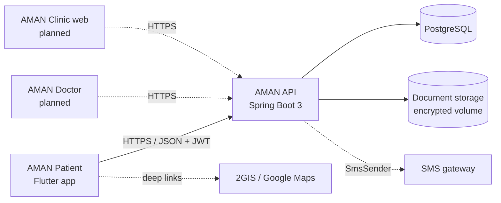

# Architecture

## System context



## Flutter client (`app/lib`)

Feature-first Clean Architecture. Dependencies point inwards:
`presentation → application → domain ← data`.

```
core/            theme (design tokens), widgets (design system), router, l10n, utils, services, config
data/demo/       in-memory synthetic backend (DemoStore) + repository adapters
data/remote/     Dio ApiClient (token refresh, error mapping) + REST repository adapters
features/<name>/
  domain/        entities, value objects, repository interfaces, pure business rules
  application/   Riverpod controllers / providers (use cases, state)
  presentation/  screens and feature widgets
```

* **State:** Riverpod (`Notifier` / `AsyncNotifier`); providers depend on `currentUserIdProvider`, so data reloads
  and nothing leaks across accounts on sign-out / sign-in.
* **Navigation:** GoRouter with a pure, unit-tested `redirectFor` guard, a `StatefulShellRoute` for the four tabs.
* **Backend switch:** `AppConfig.isDemo` selects `Demo*Repository` or `Remote*Repository` in `core/providers.dart`.
  UI code only knows the repository interfaces.
* **Business rules** (slot generation, filters, appointment grouping, change policy, document policy) are plain Dart in
  `domain/` and unit-tested without Flutter.
* **Localization:** ARB files (`app/lib/l10n`) → generated `AppL10n`. No user-visible strings in widgets. Dates, numbers and
  KZT are formatted by `AmanFormat` per locale; ICU plurals handle ru/kk/en grammar.
* **Maps:** `MapAdapter` interface; `DemoMapAdapter` renders an interactive schematic map. A Google Maps / 2GIS SDK adapter
  implements the same interface and is registered via `mapAdapterProvider` (needs a native API key). Routes open through
  deep links and need no key.

## Backend (`backend/src/main/java/kz/aman`)

```
config/    AppProperties (aman.*), SecurityConfig (JWT, RBAC, CORS), SmsConfig
security/  JwtService, JwtAuthFilter, AmanPrincipal
domain/    JPA entities (+ Loc / LocConverter for ru|en|kk text)
repo/      Spring Data repositories (patient-scoped queries for medical data)
service/   AuthService, AppointmentService, CatalogService, HealthDataService, DocumentService,
           NotificationService, AuditService, ScheduleCalculator (pure), AppointmentLifecycleJob
web/       REST controllers (thin) · dto/ request & response records with validation
common/    ApiException, ErrorCode, ApiError, GlobalExceptionHandler (uniform error body)
demo/      DemoDataSeeder (profile `demo` only)
```

* **Consistency:** double booking is prevented by the unique `appointments.active_slot_key` (`doctorId:epoch`, `NULL` when
  cancelled) — the database, not application code, is the final arbiter, so races lose with `409 SLOT_TAKEN`.
* **Schema:** Flyway migrations (`db/migration`), validated by Hibernate (`ddl-auto=validate`). Demo catalog lives in
  `db/demo` and is only loaded with the `demo` profile.
* **Time:** stored as UTC instants; schedules are interpreted in the clinic zone (`aman.booking.zone`, default `Asia/Almaty`).

## Roles and future products

| Role | URL prefix | Status |
| --- | --- | --- |
| `PATIENT` | `/api/v1/**` | implemented |
| `DOCTOR` | `/api/v1/doctor/**` | prefix reserved & enforced (deny-by-default), endpoints planned |
| `CLINIC_ADMIN` | `/api/v1/clinic/**` | same |
| `SUPER_ADMIN` | `/api/v1/admin/**` | same |

Roles never share permissions: each prefix requires exactly one role and every other request is denied.
AMAN Doctor and AMAN Clinic reuse the same domain model (`Doctor`, `DoctorSchedule`, `Appointment`, `MedicalRecordEntry`,
`LabResult`, …) and add role-specific controllers/services, so the foundation does not need to be rewritten.
