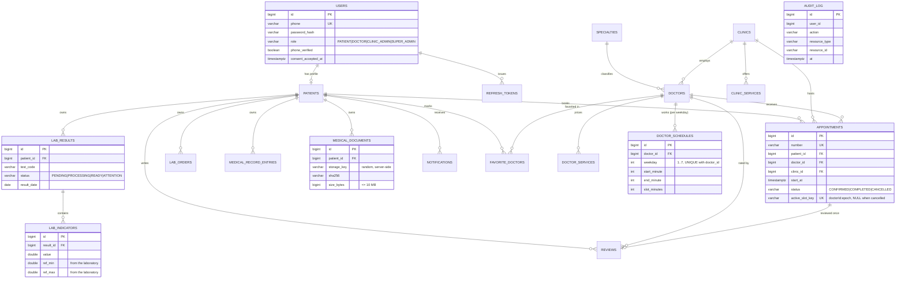

# Database ER diagram

PostgreSQL schema created by `backend/src/main/resources/db/migration/V1__init_schema.sql`.

Notable constraints: `CHECK` on ratings / prices / weekday / schedule ranges, `ck_active_slot` (an active appointment always has a
slot key, a cancelled one never), unique `(patient_id, doctor_id)` favorites, unique `(doctor_id, weekday)` schedules,
indexes on all foreign keys and the hot paths `(patient_id, start_at)`, `(doctor_id, start_at)`, `(patient_id, result_date)`.
`audit_log` has no foreign keys on purpose so that audit history survives account deletion.
